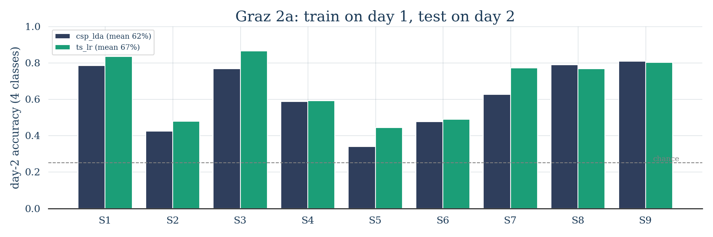
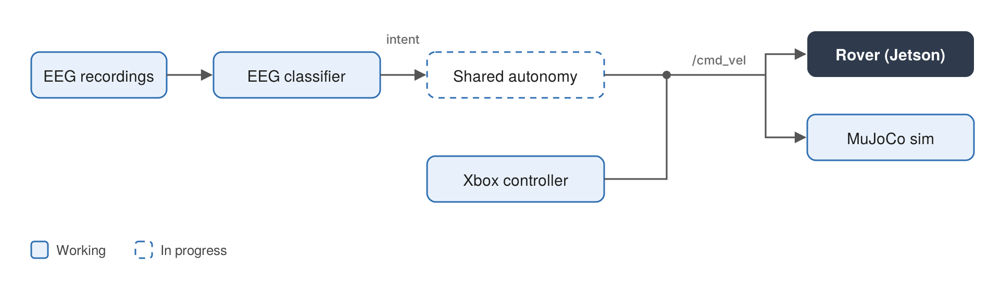
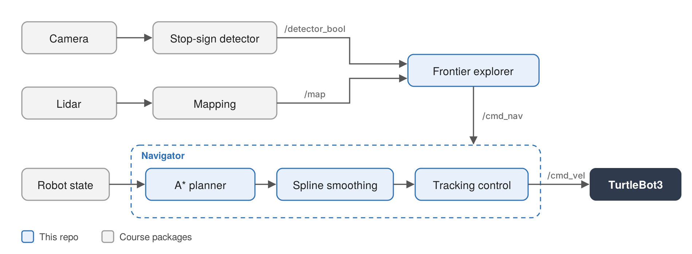
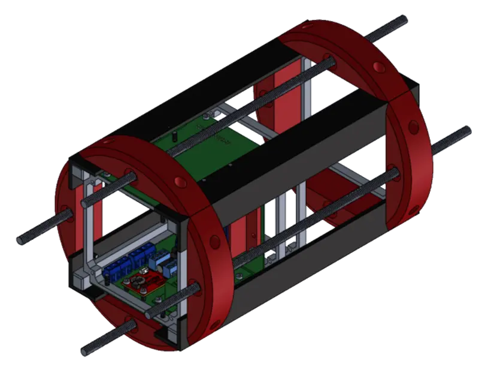
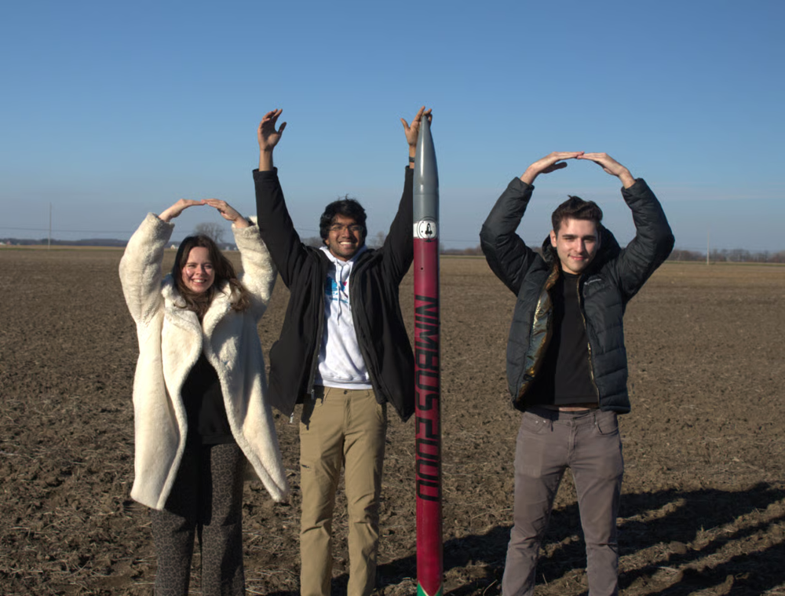
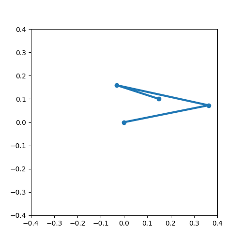
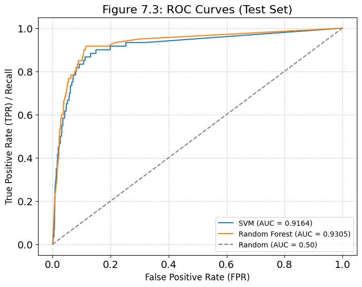

# Adam Sabet

**M.S. Electrical Engineering @ Stanford (Robotics & Autonomous Systems)** · B.S. Physics & Economics, Ohio State (4.0 GPA)

I build robots that work outside the lab: autonomy, embedded systems, and hardware that does something useful for people.
Right now that means a brain-controlled rover for assistive mobility.

[LinkedIn](https://www.linkedin.com/in/adamsabet1/) · odyssey@stanford.edu · Looking for Summer 2027 internships in robotics, autonomy, embedded and hardware

---

## Brain-Controlled Rover · Stanford ARMLab

*Graduate Researcher · Oct 2026 – Present* · [Code](https://github.com/Odysseyc/eeg-rover)

https://github.com/user-attachments/assets/1781b58b-0e76-4f36-8366-f1e6c216e170
Driving the rover with an Xbox controller in the lab.

  

  

Driving a 1:10-scale rover with a non-invasive brain-computer interface. EEG commands are slow and noisy, so the goal is
**shared autonomy**: the person chooses where to go, and the robot keeps it safe.

- Rewrote the rover's onboard driver (ROS, Jetson Orin Nano, VESC): fixed reversed steering and a reverse-throttle bug, and added ramping, a 0.5 s safety watchdog, and Xbox control with an E-stop
- Bridged ROS 2 on the laptop to ROS 1 on the rover over Wi-Fi, with live onboard video
- Built a MuJoCo simulation with lidar and camera that takes the same commands as the real rover
- EEG decoding on BCI Competition IV 2a (4 classes, cross-session): **67.1%** vs. 25% chance, up to 86% for the best subject

`ROS 1 / ROS 2` `Python` `MuJoCo` `NVIDIA Jetson` `scikit-learn` `pyRiemann`

---

## Autonomous TurtleBot Navigation & Exploration · Stanford CS 237A

*Sept – Nov 2026* · [Code](https://github.com/Odysseyc/turtlebot-autonomy)

  

A full autonomy stack that explores an unknown environment on its own, tested in Gazebo and then run on a real TurtleBot3.

- Navigation: A* on the occupancy grid, cubic-spline smoothing, and a differential-flatness tracking controller
- Frontier exploration that picks the next goal from the live map and recovers from failed goals
- Stops for 5 s at stop signs seen by an onboard detector, without re-triggering on the same sign

`ROS 2` `Python` `Gazebo` `RViz` `TurtleBot3`

---

## Karl's Kitchen: Interactive Microwave Game · Stanford ME 218A

*Integration & Hardware Lead, team of 4 · Oct – Nov 2026* · [Code](https://github.com/Odysseyc/ME218A-2026-Project)

https://github.com/user-attachments/assets/50c30bc6-8d2b-4f78-b6f5-6b796023443e
The finished game: a microwave-style box with a spinning plate, LEDs and an LED-matrix timer.

A microwave-themed arcade game: turn a knob to spin the plate toward whichever LED lights up, and fill the cooking meter
before time runs out to win a treat.

- Designed the KiCad schematic around a PIC32: Hall-effect sensors, shift-register LED chain, SPI LED matrices, and two DC gearmotors on an H-bridge
- Wrote the event-driven game state machine in C, plus a desktop simulator to test it without hardware
- Designed the laser-cut and 3D-printed enclosure and treat dispenser, and merged the team's code into the final game

`C` `PIC32` `KiCad` `PWM` `SPI` `Laser cutting` `3D printing`

---

## NASA Student Launch Initiative · Ohio State

*Deputy Project Manager, previously Avionics · Aug 2023 – May 2026* · [Simulations](https://github.com/saividyud/NASA_25-26_Rocket_Simulations) · [bsli.space](https://www.bsli.space/)

  

  

- Designed the avionics bay in CAD and Altium and machined its parts on mills and lathes to flight tolerances
- As Deputy PM, led systems integration across avionics, recovery and structures, and directed full-vehicle testing
- Developed OpenRocket vehicle models and ran Monte Carlo flight simulations under wind and weather uncertainty
- Defended our design and safety decisions to NASA engineers in formal reviews; the team consistently ranked in the top 20 of 80+ universities

`SolidWorks` `Onshape` `Altium` `CNC machining` `Raspberry Pi` `OpenRocket`

---

## 3-DOF Robotic Arm · Independent Project

*Jun 2026 – Present* · [Code](https://github.com/Odysseyc/3dof-robotic-arm)

  

Learning manipulation from first principles. I derived the forward and inverse kinematics by hand, then implemented them with
AI-assisted coding and verified the math myself.

- Analytical inverse kinematics, trajectory generation, and PID control, validated in PyBullet and visualized in RViz
- Arduino firmware that drives the servos from serial joint commands; physical assembly is next

`Python` `ROS 2` `PyBullet` `URDF` `Arduino`

---

## Tin-Tungsten Deposit Prediction · Ohio State Big Data Analytics in Physics

*Aug – Dec 2025* · [Code](https://github.com/Odysseyc/Tin-Tungsten-Prediction)

  

Random Forest and SVM classifiers that map where tin-tungsten deposits are likely in Tasmania from geophysical survey data.
The Random Forest reached **0.93 AUC**, and 43% of the cells it flagged were real deposits when only 4% of cells contain one.

`Python` `scikit-learn` `GeoPandas` `imbalanced-learn`

---

## Skills

- **Robotics:** ROS / ROS 2, Gazebo, MuJoCo, PyBullet, RViz, motion planning, trajectory tracking, kinematics, PID control
- **Embedded & electrical:** PIC32, NVIDIA Jetson, Arduino, Raspberry Pi, PWM motor control, H-bridges, SPI, KiCad, Altium
- **Mechanical:** SolidWorks, Onshape, CNC mill and lathe, laser cutting, 3D printing
- **Software & ML:** Python, C, C++, MATLAB, Git, Linux, Docker, NumPy, scikit-learn, PyTorch
